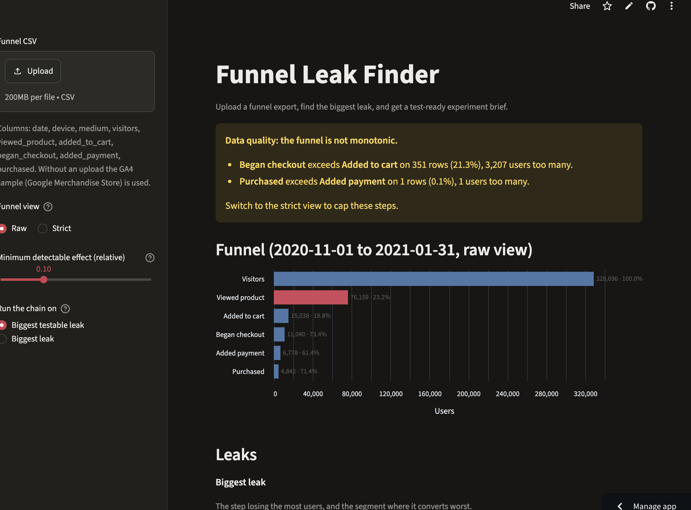
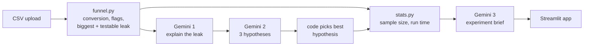

# Funnel Leak Finder

> For growth PMs at e-commerce companies: upload a funnel export, see where it leaks and for which segment, and get 3 hypotheses plus a test-ready A/B experiment brief, in under a minute.

### [▶ Live demo](https://funnelleaker.streamlit.app/)

**PM:** Kapil Babel · **Sprint 3** · **Cost:** €0

## The problem
Finding where the funnel leaks, at which step and for which segment, takes days of analyst time. Turning that into a testable experiment with hypotheses, a metric and a sample size takes more time again, so experiments start late or aren't sized properly.

## What it does


1. Upload a funnel CSV (one row per day × device × medium, six funnel steps) or use the bundled GA4 sample.
2. See the funnel, data-quality warnings, the **biggest leak** and the **biggest testable leak**.
3. Click *Generate*: a 3-step Gemini chain explains the leak, proposes 3 hypotheses and writes an experiment brief for the best one, with sample size and run time computed in code.

## Findings
On the GA4 sample (Google Merchandise Store, Nov 2020–Jan 2021, 328,696 visitors):

**1. The tool works, and it's honest about its data.**
- **Data quality is checked, not assumed.** In 21% of rows (351 of 1,649), more users began checkout than added to cart. The app flags this, and the *strict* view caps each step at the previous one: purchases drop from 4,842 to 3,872 (−20%). The LLM must say how the flags limit its conclusion.
- **Every leak gets a testability check.** A leak is only useful if a team can test a fix in reasonable time, so each one comes with an A/B test run time.
- **Stats are in code.** Conversion rates, sample sizes and run times come from `funnel.py` and `stats.py`, never from the LLM, and the funnel numbers matched the manual check (23.2% visitor → product view).

**2. On this dataset the segments barely differ, so the real opportunity is the step itself.**
- About 77% of all visitors never view a product, and only ~20% of product viewers add to cart.
- The segments convert almost the same at the product-view step: device within ±0.1 pp, medium within ~2.5 pp.
- So the leak to fix is "visitor → product view" for everyone, not a segment. In the latest run the chain's chosen test was an all-users page-speed change, with a 4-day run time.

**3. Testability matters more on data with real segment differences.** This example shows why:

| Segment at visitor → product view | Gap vs. 23.2% overall | Test run time, MDE 10% | Test run time, MDE 15% |
|---|---|---|---|
| cpc (paid ads): converts worst | −2.4 pp | 75 days | 34 days |
| organic: biggest testable leak | −1.0 pp | 10 days | 5 days |

The worst segment isn't always the one to test: only ~166 paid visitors a day reach this step, so a cpc test takes months. The testable-leak ranking picks the largest leak whose test fits in 28 days. Here the gaps are too small for that to matter much. On a shop where, say, mobile converts far worse than desktop, it decides which test to run first.

## Results
| Metric | Target | Result |
|---|---|---|
| Accuracy | Leak matches our manual analysis | ✅ Pass with fixes (manual check, P3-07): funnel numbers verified (23.2% matches the CSV) and the anonymisation exclusions are correct. Segments barely differ (device ±0.1 pp, medium within ~2.5 pp), so the real opportunity is the whole visitor → product view step, not a segment. One infeasible hypothesis (search-keyword headlines); prompt fixed |
| Test-ready brief | Hypothesis, metric, control, variant, sample size, run time, decision rule | ✅ 7/7 in all 5 logged runs |
| Numbers correct | Brief's sample size and run time = code | ✅ Enforced in code, and the model copied them correctly in every run |
| Speed | < 60 s | ✅ 3 of 3 runs since the 20 s timeout: 5.6 s, 56.2 s, 46.0 s (the slow ones because of 503s and timeouts). Before it, one run took 114 s |
| Cost | €0 | ✅ Gemini free tier, BigQuery sandbox, Streamlit Community Cloud |

Details: [docs/04-evals.md](docs/04-evals.md).

## How it works


- **Numbers in code, words by the LLM.** [`app/funnel.py`](app/funnel.py) computes conversion per step and segment, data-quality flags, the strict view and both leak rankings. [`app/stats.py`](app/stats.py) computes the sample size per variant (two-sided two-proportion test, alpha 0.05, power 0.8) and run time. The LLM never calculates.
- **A 3-step chain**, [`app/chain.py`](app/chain.py), where each step's output is the next step's input: (1) explain the leak for the selected segment, (2) 3 hypotheses with expected impact and confidence, (3) the brief for the best one. Prompts are in [`prompts/`](prompts/). Gemini in JSON mode, low thinking.
- **Checks between steps:** step 1 must name the segment or it is retried once; the code chooses the best hypothesis and overwrites the brief's sample size and run time with its own.
- **Reliability:** `gemini-3.1-flash-lite` by default, with fallback to `gemini-3.8-flash` (and back) on 503s or calls over 20 s. The whole chain has a 60 s budget; past it, the app shows the finished steps and "Model too slow, try again". The model per step and every timeout are logged.

## Key product decisions
- [ADR-001: CSV upload instead of a live BigQuery connection](docs/decisions/ADR-001-csv-not-live-bigquery.md)
- [ADR-002: Funnel metrics and sample size in code, not by the LLM](docs/decisions/ADR-002-stats-in-code-not-llm.md)
- [ADR-003: flash-lite by default, fall back between models on overload](docs/decisions/ADR-003-model-fallback.md)

## Limitations & what's next
- **Step counts are not a user-level funnel.** Each step counts users per day separately; the strict view is a cap, not a true user journey. A user-level funnel needs the export to follow sessions through steps.
- **One dataset, 3 months, a US merch store.** Results aren't validated on a German shop. Segments are device and medium only; country is in the v2 backlog.
- **The hypotheses are generic.** The LLM only sees aggregate numbers, not the pages, so its ideas (landing pages, navigation) are plausible but unspecific. Combining it with page screenshots (P1's teardown) is a natural next step.
- **Free-tier latency.** 2 of 3 runs needed retries and took 46–56 s, close to the 60 s limit.
- **Run time assumes every user at the step enters the test**, split evenly between 2 variants.

## Built with
Python · pandas · Streamlit · Altair · Gemini API (`gemini-3.1-flash-lite`, `gemini-3.8-flash`, free tier)

**Data:** [Google Analytics 4 obfuscated sample e-commerce dataset](https://developers.google.com/analytics/bigquery/web-ecommerce-demo-dataset) (Google Merchandise Store), `bigquery-public-data.ga4_obfuscated_sample_ecommerce`, from the BigQuery public datasets program. The data is obfuscated by Google; `(data deleted)` and `<Other>` are its anonymisation buckets.

## Run locally
Needs Python 3.11+ and a free Gemini key from [Google AI Studio](https://aistudio.google.com).

```bash
python3 -m venv .venv && source .venv/bin/activate
pip install -r requirements.txt
cp .env.example .env               # add GEMINI_API_KEY
streamlit run app/app.py           # http://localhost:8501
```

- Command line: `python -m app.chain [--strict] [--mde 0.10] [--leak testable|biggest]`
- Tests: `pytest -q`

**Streamlit Community Cloud:** deploy from this repo with main file `app/app.py` and Python 3.12, and paste the contents of [`.streamlit/secrets.toml.example`](.streamlit/secrets.toml.example) with your key into the app's *Secrets*.
